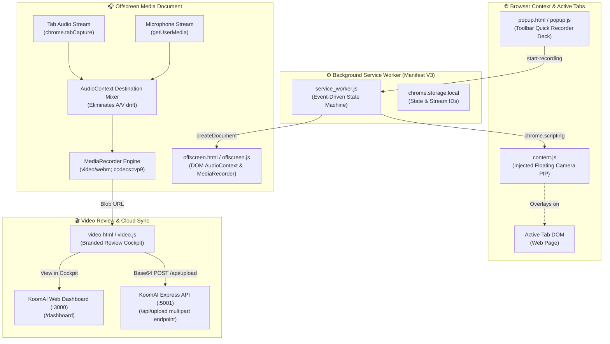
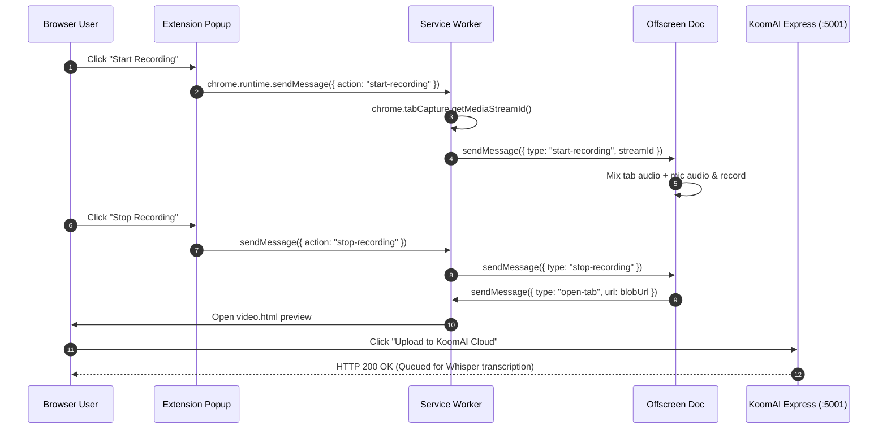

# 🏗️ KoomAI Chrome Extension — Manifest V3 Architecture

## 1. System Design & Architectural Context

`koom-ai-chrome-extension` is a high-performance browser screen recording extension engineered under the **Google Chrome Manifest V3 specification**. It overcomes Manifest V3's strict constraints (ephemeral service workers, no DOM access in service workers, restricted background media recording) using an **Offscreen Document Audio Mixing Pipeline**.



---

## 2. Manifest V3 Technical Innovations

### ADR-01: Ephemeral Service Worker vs Persistent Media Stream
- **Challenge**: In Manifest V3, background scripts are replaced by ephemeral Service Workers that terminate after 30 seconds of inactivity and cannot access the DOM or `MediaRecorder`.
- **Solution**: The extension dynamically spawns an **Offscreen Document** (`chrome.offscreen.createDocument({ reasons: ['USER_MEDIA'], justification: 'Recording tab and mic audio' })`).
- **Outcome**: Uninterrupted, reliable recordings spanning hours without service worker termination.

### ADR-02: Zero-Latency Dual-Stream Audio Mixing
- **Challenge**: Capturing both tab audio (meeting sound, video playback) and microphone audio causes out-of-phase audio echoes or browser clipping.
- **Solution**: Blends streams using the Web Audio API inside `offscreen.js`:
  ```javascript
  const mixedContext = new AudioContext();
  const mixedDest = mixedContext.createMediaStreamDestination();
  mixedContext.createMediaStreamSource(microphone).connect(mixedDest);
  mixedContext.createMediaStreamSource(tabMedia).connect(mixedDest);
  ```
- **Outcome**: Studio-quality mixed audio with hardware echo cancellation and zero latency.

---

## 3. Communication & Message Flow



---

## 4. Permissions Matrix

| Permission | Justification |
| :--- | :--- |
| `tabCapture` | Captures high-definition audio and video from the user's active browser tab. |
| `desktopCapture` | Allows full desktop or application window screen recording. |
| `offscreen` | Spawns dedicated DOM context for real-time audio mixing and MediaRecorder. |
| `scripting` | Dynamically injects the circular webcam floating overlay (`content.js`). |
| `storage` | Preserves local recording state and temporary video object URLs. |
| `activeTab` | Grants temporary execution rights on the currently focused browser tab. |
