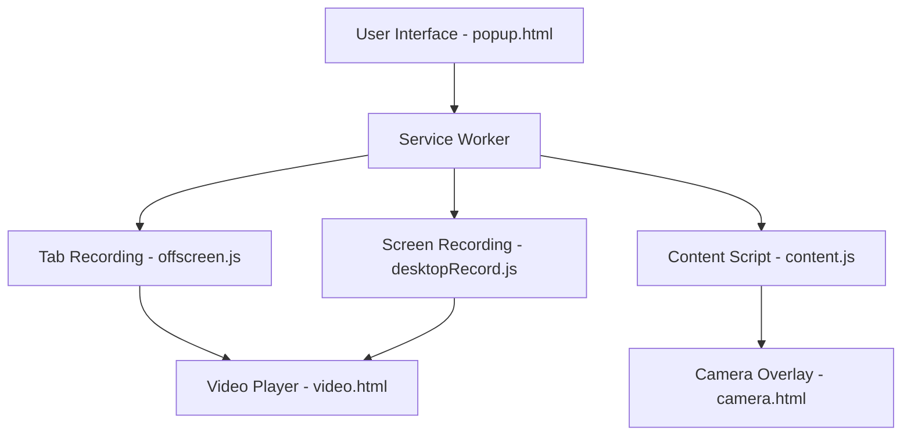

# 📹 Koom AI Chrome Extension

A powerful Chrome extension for screen and tab recording with webcam overlay, screenshots, and professional-quality video output.


## ✨ Features

### 🎬 Recording Options
- **📹 Tab Recording** - Record current browser tab with audio + optional webcam overlay
- **🖥️ Screen Recording** - Capture entire screen with system audio + microphone
- **🪟 Window Recording** - Record specific application windows
- **📸 Screenshot** - Capture high-quality PNG screenshots

### 🎥 Advanced Features
- **📷 Draggable Camera Overlay** - Movable webcam preview during tab recording
- **🎤 Dual Audio** - Records both system audio and microphone
- **🔴 Live Controls** - Show/hide/toggle camera during recording
- **💾 Auto Download** - Automatically saves to Downloads folder
- **⚡ Background Processing** - Offscreen documents for optimal performance
- **🎨 Beautiful UI** - Gradient design with smooth animations

## 🚀 Quick Start

### Installation

1. **Clone the repository**
   ```bash
   git clone https://github.com/yourusername/koom-ai-chrome-extension.git
   cd koom-ai-chrome-extension
   ```

2. **Load in Chrome**
   - Open `chrome://extensions/`
   - Enable **Developer mode** (toggle in top right)
   - Click **Load unpacked**
   - Select the extension folder

3. **Pin the Extension**
   - Click extensions icon (puzzle piece)
   - Pin Koom AI Recorder

### Usage

#### 📹 Tab Recording (with Webcam)
1. Click extension icon
2. Choose **Show/Hide** webcam preference
3. Click **Record Current Tab**
4. Webcam overlay appears (draggable)
5. Use **Live Camera Controls** to toggle visibility
6. Click **Stop Recording** when done

#### 🖥️ Screen Recording
1. Click extension icon
2. Click **Record Screen**
3. Select screen/window in picker
4. Recording starts automatically
5. Original tab regains focus
6. Stop from the pinned recording tab

#### 🪟 Window Recording
1. Click extension icon
2. Click **Record Window**
3. Select specific window
4. Recording starts
5. Stop when finished

#### 📸 Screenshot
1. Click extension icon
2. Click **Take Screenshot**
3. Choose save location
4. PNG file downloaded

## 📁 Project Structure

```
koom-ai-chrome-extension/
├── 📋 manifest.json           # Extension configuration
├── 🎨 popup.html/js           # Main UI interface
├── 🔧 service_worker.js       # Background recording manager
├── 💉 content.js              # Camera overlay injection
├── 🎬 offscreen.html/js       # Tab recording handler
├── 🖥️ desktopRecord.html/js  # Screen/window recording
├── 📸 camera.html/js          # Webcam component
├── 🎥 video.html/js           # Video player
└── 🎭 icons/                  # Extension icons
```

## 🔧 Technical Details

### Architecture Overview



### Key Technologies

| Technology | Purpose |
|------------|---------|
| **Manifest V3** | Latest Chrome extension standard |
| **Service Worker** | Background script for state management |
| **Offscreen Documents** | Tab recording without UI |
| **MediaRecorder API** | Video/audio capture |
| **Web Audio API** | Audio stream mixing |
| **Chrome APIs** | Tab capture, desktop capture, scripting |

### Permissions Required

```json
{
  "permissions": [
    "tabCapture",       // Record browser tabs
    "desktopCapture",   // Record screen/windows
    "offscreen",        // Background documents
    "scripting",        // Inject camera overlay
    "storage",          // Save state
    "tabs",             // Tab management
    "downloads"         // Auto-save videos
  ]
}
```

### Recording Formats

- **Video Codec**: VP9
- **Audio Codec**: Opus
- **Container**: WebM
- **Screenshot**: PNG (100% quality)

## 🎯 Features in Detail

### 📷 Camera Overlay

- **Draggable**: Click and drag to reposition
- **Boundary Detection**: Stays within viewport
- **Hover Effects**: Smooth scale animations
- **Mirror Mode**: Flipped horizontally for natural view
- **Circular Design**: 200px diameter with gradient border

### 🎤 Audio Recording

**Tab Recording:**
- Tab audio (system sounds)
- Microphone input
- Mixed using Web Audio API

**Screen/Window Recording:**
- System audio
- Optional microphone
- Combined audio tracks

### 💾 Video Processing

1. **Recording**: Data collected in 1-second chunks
2. **Blob Creation**: Chunks combined into single blob
3. **Base64 Encoding**: For cross-context transfer
4. **Player Loading**: Decoded and played in video.html
5. **Download**: WebM file saved to Downloads

## 🛠️ Development

### Prerequisites

- Chrome 116+
- Basic JavaScript/HTML/CSS knowledge
- Developer Mode enabled

### Local Development

1. **Make changes** to any file
2. **Reload extension** in `chrome://extensions/`
3. **Test functionality**
4. **Debug**:
   - Popup: Right-click icon → "Inspect popup"
   - Service Worker: Click "service worker" link
   - Content Script: Regular DevTools
   - Offscreen: Check offscreen document logs

### File Responsibilities

| File | Purpose | Key Functions |
|------|---------|---------------|
| `popup.js` | UI interactions | Recording controls, status updates |
| `service_worker.js` | Background logic | State management, message routing |
| `content.js` | Page injection | Camera overlay creation/control |
| `offscreen.js` | Tab recording | MediaRecorder for tabs |
| `desktopRecord.js` | Screen/window | Desktop capture handling |
| `camera.js` | Webcam | Camera stream management |
| `video.js` | Playback | Video decoding and player |

### Message Flow

```javascript
// Popup → Service Worker
chrome.runtime.sendMessage({
  action: 'start-recording',
  type: 'tab',
  webcamEnabled: true
});

// Service Worker → Offscreen
chrome.runtime.sendMessage({
  action: 'start-recording',
  data: streamId
});

// Service Worker → Content Script
chrome.tabs.sendMessage(tabId, {
  action: 'show-camera'
});
```

## 🚨 Troubleshooting

### Common Issues

| Issue | Solution |
|-------|----------|
| Camera not showing | Check permissions, reload extension |
| Recording not starting | Verify active tab, check console |
| No audio in recording | Grant microphone permission |
| Video player blank | Check base64 data transfer |
| Screen picker not appearing | Reload extension, try again |

### Debug Steps

```bash
# Check extension status
chrome://extensions/

# View service worker logs
Click "service worker" in extension details

# Debug popup
Right-click icon → "Inspect popup"

# Check offscreen logs
Inspect offscreen document when recording

# View storage
DevTools → Application → Storage → Extensions
```

### Error Messages

| Error | Meaning | Fix |
|-------|---------|-----|
| "No active tab found" | No tab to record | Open a valid webpage |
| "Camera permissions denied" | No camera access | Enable in site settings |
| "Recording already in progress" | Duplicate start | Stop current recording first |
| "Failed to execute readAsDataURL" | Blob error | Check blob creation |

## 🎨 Customization

### Camera Styling

Edit `content.js`:

```javascript
cameraElement.setAttribute("style", `
  width: 300px;          // Change size
  height: 300px;
  border-radius: 150px;  // Keep circular
  border: 5px solid #ff0000;  // Custom color
`);
```

### Recording Quality

Edit `offscreen.js` or `desktopRecord.js`:

```javascript
recorder = new MediaRecorder(stream, {
  mimeType: 'video/webm;codecs=vp9,opus',
  videoBitsPerSecond: 8000000,  // 8 Mbps
  audioBitsPerSecond: 128000    // 128 kbps
});
```

## 🤝 Contributing

1. Fork the repository
2. Create feature branch: `git checkout -b feature/amazing-feature`
3. Commit changes: `git commit -m 'Add amazing feature'`
4. Push to branch: `git push origin feature/amazing-feature`
5. Open Pull Request

### Development Guidelines

- Use Manifest V3 APIs only
- Add error handling for all async operations
- Include console logging for debugging
- Test across different scenarios
- Update documentation

## 📊 Performance

- **Minimal CPU usage** during recording
- **Efficient memory management** with chunked data
- **Background processing** doesn't interfere with browsing
- **Optimized video encoding** with VP9/Opus

## 🔒 Privacy & Security

- **No data collection** - Everything stays local
- **No external servers** - All processing in-browser
- **Permissions only when needed** - Clear permission requests
- **User control** - Full control over recordings

## 📄 License

This project is licensed under the MIT License.

## 🙋 Support

- **Issues**: [GitHub Issues](https://github.com/yourusername/koom-ai-chrome-extension/issues)
- **Discussions**: [GitHub Discussions](https://github.com/yourusername/koom-ai-chrome-extension/discussions)

## 🌟 Acknowledgments

- Chrome Extensions Documentation
- MediaRecorder API Specifications
- Web Audio API Reference
- Community Contributors

## 🎯 Roadmap

- [ ] Video trimming in player
- [ ] Multiple video formats (MP4, AVI)
- [ ] Cloud upload integration
- [ ] Annotation tools
- [ ] Picture-in-picture mode
- [ ] Countdown timer before recording

---

**Made with ❤️ for content creators and developers**

**⭐ Star this repo if it helps you!**

## 📈 Stats


